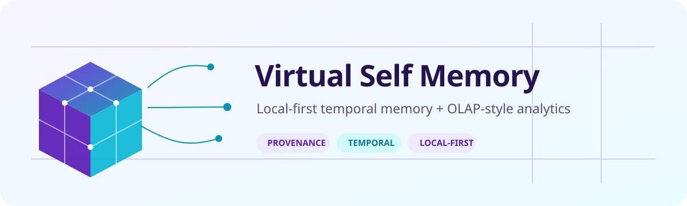
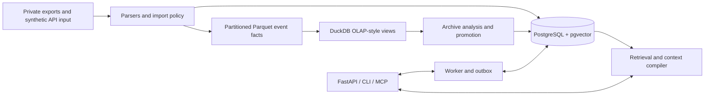

<picture>
  <source media="(prefers-color-scheme: dark)" srcset="docs/readme/header-dark.svg">
  <source media="(prefers-color-scheme: light)" srcset="docs/readme/header-light.svg">
  
</picture>

# Virtual Self Memory

A local-first memory and analytics service for personal agents. It combines versioned memories in PostgreSQL, provenance links back to source evidence, temporal life layers, vector and lexical retrieval, background workers, and an OLAP-style archive path built on partitioned Parquet and DuckDB.

The OLAP claim is deliberately narrow: the implementation normalizes archive exports into event facts and exposes aggregate views by day, product, domain, month, place, and contact. It is not a general-purpose data warehouse.

## What is different

- **Temporal memory:** authored, valid, observed, and ingestion time are modeled separately, with explicit precision and source labels.
- **Evidence and provenance:** artifact and derivation tables connect sources, evidence records, memory versions, personality proposals, and archive events.
- **OLAP-style archive analysis:** providers are parsed into a shared event schema, partitioned by provider/product/year, queried in-process with DuckDB, and summarized through reusable views.
- **Hybrid retrieval:** PostgreSQL full-text ranking and pgvector similarity are fused for context compilation.
- **Local-first boundary:** the API binds to loopback by default; corpus mounts are read-only; generated state and databases are ignored by Git.
- **Agent-independent interfaces:** FastAPI, a Click CLI, worker jobs, and an MCP server share the same governed memory core.

## Architecture



Raw corpus files, Parquet datasets, DuckDB files, embeddings, logs, generated profiles, and local state stay outside the repository.

## Quick start

Requirements: Docker with Compose v2, plus an optional local Ollama or OpenAI-compatible endpoint for embeddings and enrichment.

```bash
cp .env.example .env
mkdir -p .state private/corpus private/archive

# Fill POSTGRES_PASSWORD, VSM_BOOTSTRAP_TOKEN, and
# VSM_FIELD_ENCRYPTION_KEY in .env before starting.
docker compose run --rm migrate
docker compose up -d postgres api worker
curl http://127.0.0.1:8090/health/ready
```

Generate secrets locally:

```bash
openssl rand -hex 32
python3 -c 'from cryptography.fernet import Fernet; print(Fernet.generate_key().decode())'
```

Configuration is environment-driven; `.env.example` documents the supported local services, archive path, worker controls, and optional web gateway. Never commit `.env`, corpus exports, or generated state.

## Synthetic API example

The first authenticated request exchanges the configured bootstrap token for a hashed database credential.

```bash
export VSM_TOKEN='your-local-bootstrap-token'

curl -sS http://127.0.0.1:8090/v1/memories \
  -H "Authorization: Bearer ${VSM_TOKEN}" \
  -H 'Content-Type: application/json' \
  -H 'Idempotency-Key: demo-pref-001' \
  -d '{
    "kind": "preference",
    "content": "Fictional user Casey prefers weekly project summaries.",
    "scope": "demo",
    "trust": "user_asserted",
    "sensitivity": 0
  }'

curl -sS http://127.0.0.1:8090/v1/memories/search \
  -H "Authorization: Bearer ${VSM_TOKEN}" \
  -H 'Content-Type: application/json' \
  -d '{"query":"weekly summaries","limit":5}'
```

Useful CLI entry points:

```bash
virtual-self migrate
virtual-self health
virtual-self import-my-life --dry-run --root ./private/corpus
virtual-self archive olap-refresh
virtual-self archive status
virtual-self mcp
```

## Data and privacy model

- Source corpus and archive mounts are private inputs, not project assets.
- Sensitive evidence can be encrypted at the field layer; credentials are hashed at rest.
- Imports are read-only and policy-gated; deletion and suppression tables support governed forgetting.
- Container filesystems are read-only, privileges are dropped, and public ports bind to `127.0.0.1`.
- Archive synchronization, LLM enrichment, notifications, and web retrieval are optional.
- Test fixtures in this repository are synthetic. Do not substitute real exports in tracked paths.

This is privacy-oriented engineering, not a claim of formal compliance or a substitute for deployment review.

## Development

```bash
python3 -m venv .venv
. .venv/bin/activate
pip install -e '.[dev]'
ruff check .
pytest
```

Docker configuration can be checked without starting services:

```bash
POSTGRES_PASSWORD=example VSM_ENV_FILE=.env.example \
  docker compose --env-file .env.example config
```

## Project status

**Experimental / pre-1.0.** The schema, import pipeline, archive parsers, API, worker, retrieval, temporal evaluation, and OLAP-style views are implemented and tested. Operational defaults still require local secrets and private data mounts; review retention, encryption, model access, and network policy before using real personal data.

Licensed under the [MIT License](LICENSE).
